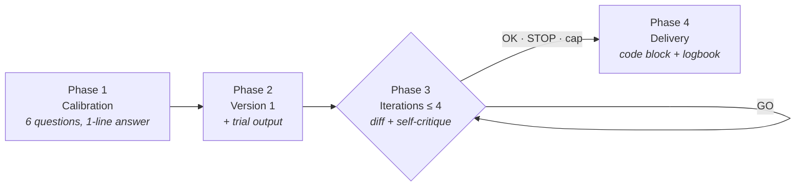
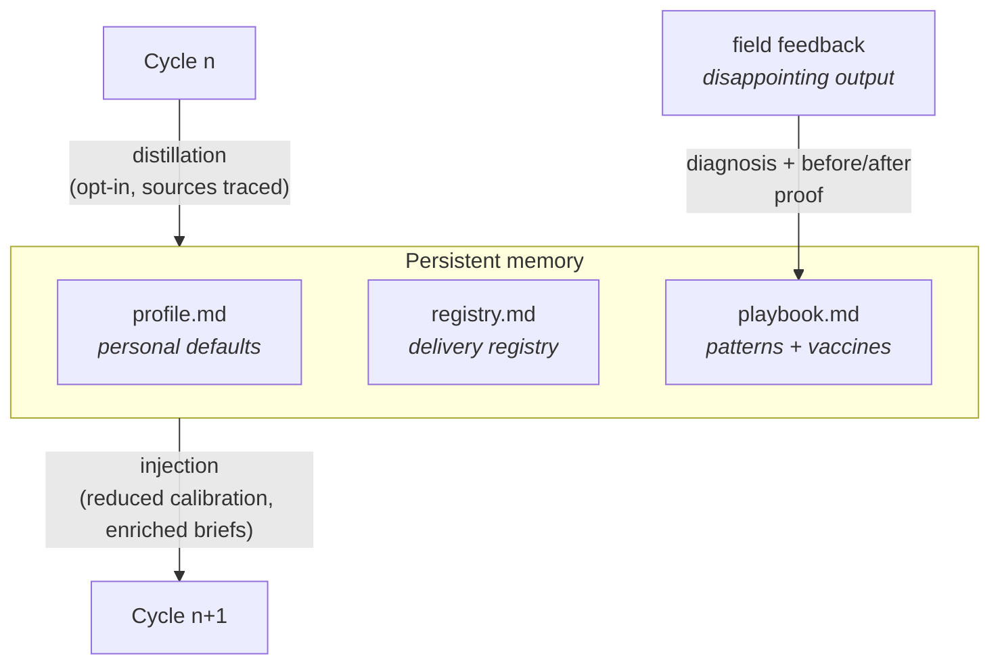

<p align="center">
  
</p>

<h1 align="center">Promptor</h1>

<p align="center"><b>English</b> · <a href="README.fr.md">Français</a></p>

<p align="center"><i>The interaction is in French; the final prompt's language follows the target tool.</i></p>

<p align="center"><b>A prompt's text proves nothing. Its output does.</b></p>

<p align="center">
Custom prompt architect for ChatGPT, Claude, Gemini, Midjourney, Cursor, and autonomous agents.<br>
A human-driven iterative protocol, scoring anchored in explicit criteria,<br>
and persistent memory that makes each cycle better — and cheaper — than the last.
</p>

<p align="center">
  
  
  
  
</p>

---

## The problem

Prompts are everywhere; good prompts are nowhere. Three flaws doom most prompt generators:

1. **They score the text, not the result.** A well-built structure can produce mediocre output — and vice versa. Judging a prompt without running it is like judging a recipe without tasting the dish.
2. **They decide on their own.** The AI awards itself "5 stars" and stops — inflated score, implicit criteria, no real human oversight.
3. **They forget everything.** Every session starts from scratch: same questions, same settings, same mistakes. No capital is ever built up.

Promptor tackles all three flaws head-on:

- **Observed-performance gate** — no prompt converges until it has run on a real trial input.
- **Anchored C1–C5 rubric** — every score requires a verbatim quotation of the passage that justifies it; stopping belongs exclusively to the human (`OK` / `STOP`) or to the hard cap of 4 iterations.
- **Three-tier memory** — profile, registry, playbook: calibration shrinks with use, and every field failure vaccinates future prompts.

## Two ways to use it

| | Chat version | Skill version (Claude Code) |
|---|---|---|
| **Installation** | Copy and paste [`PROMPTOR.md`](PROMPTOR.md) into ChatGPT, Claude.ai, Gemini, or Mistral | Copy `skill/` to `~/.claude/skills/promptor/` |
| **Evaluation** | Labeled `[SORTIE D'ESSAI — simulation]` (simulated trial output) at every iteration | **Tournament: 3 variants actually executed**, judged blind on their outputs |
| **Memory** | Portable `[CARNET DE BORD]` (logbook), to be copied from session to session | `profile.md`, `registry.md`, `playbook.md` — persistent and self-distilling |
| **Field feedback** | `RETOUR :` (feedback) shortcut | `retour` (feedback) command with before/after proof |
| **Marginal cost** | `EXPRESS` / `RAPPEL` (recall) shortcuts | `--again`: occurrence n+1 is nearly free |

## Quick start (chat version)

1. Copy the entire block from [`PROMPTOR.md`](PROMPTOR.md) into a new chat.
2. Answer the 6 calibration questions — a single line is enough: `1a ChatGPT, 2 : summary of my meeting notes, 3b, 4 défaut, 5 : no jargon, 6 décide pour moi` (`défaut` applies the default; `décide pour moi` lets Promptor decide).
3. Steer with 5 commands: `GO` (iterate) · `OK` (finalize) · `STOP` (deliver as is) · `VOIR` (full version) · `?` (rephrase).
4. Retrieve the final prompt as a code block, then **copy the [CARNET DE BORD] into your next session**: calibration shrinks with each use.

In a hurry? A single message: `EXPRESS : a prompt that turns my raw notes into a structured meeting summary` — direct delivery, hypotheses logged, one corrective iteration offered.

## The protocol



Each working message shows: a status header (`Itération : i/4 · Note : n/10`, i.e. iteration i/4, score n/10), a **D/H** log (locked decisions / reversible hypotheses), the applied calibration, the working version, its trial output, a tabular self-critique with quotations, and a round of questioning capped at 3 questions labeled `[BLOQUANTE]` (blocking) or `[OPTIONNELLE]` (optional).

### The scoring rubric

| # | Criterion | What is measured |
|---|---|---|
| C1 | Task clarity | Single task, action verb, named deliverable |
| C2 | Context specificity | Audience, usage setting, source material |
| C3 | Constraint completeness | Tone, length, prohibitions, edge cases |
| C4 | Testable output format | Verifiable point by point |
| C5 | Tool-family conformance | Calibration table + learned patterns |
| **C6** | **Observed performance** | **Gate: no convergence without a compliant trial output** |

Three integrity rules make the score incorruptible: every 2/2 requires a **verbatim quotation**; the header score is **strictly equal** to the table total; the score **diagnoses but never decides** when to stop.

## The skill: a system that learns



<p align="center">
  
</p>

- **Output tournament** — on the `--deep` path, the 3 candidate variants are executed in parallel on your trial input; a judge ranks the **outputs blind**, then you make the final call based on excerpts A/B/C. Validated winning outputs become the few-shot examples in the final prompt — never invented examples.
- **Shrinking calibration** — an answer given 3 times is promoted to a personal default (opt-in). `--again "<new goal>"` replays the last calibration: *"do it like last time, but for X"*.
- **`retour` clinic** — paste a disappointing real output: diagnosis of the faulty clause (quoted), minimal fix, **before/after proof** by re-running on the failing input. The failure pattern is distilled into a vaccine: on the 2nd occurrence, it is automatically injected into all future prompts of that family.
- **Proportional ceremony** — automatic routing: simple need → express path (1 variant, direct delivery); reusable prompt or agent → deep path (panel + tournament). `--improve` touches up an existing prompt in a single turn, with the diff applied directly in the source file.
- **Built-in knowledge base** — current best practices for 34 tools (GPT-5.x, Claude, Gemini, Mistral, Midjourney V8, Flux, Cursor, agents…), drawn from research on the official documentation that was **adversarially verified** (measured reliability ~95-98%), preloaded as 27 dated calibration sheets. The skill starts out informed and refreshes itself sheet by sheet. [Methodology](docs/BEST-PRACTICES.md)

### Installation

```bash
git clone https://github.com/alebgl77/promptor.git
cp -r promptor/skill ~/.claude/skills/promptor
```

Then, in Claude Code:

```
/promptor                     # full cycle (auto-routing express/deep)
/promptor --again "goal"      # replays the last calibration
/promptor --improve file      # quick in-place touch-up
/promptor retour <slug>       # field-feedback clinic
/promptor --list              # delivery registry
```

## Supported tool families

The built-in calibration table encodes the construction conventions specific to each family — and the matching epistemic-honesty safeguard:

| Family | Examples | Encoded specifics |
|---|---|---|
| LLM chatbot | ChatGPT, Claude, Gemini, Mistral | Role, tagged sections, format at the end of the prompt, conditional few-shot |
| Image generator | Midjourney, DALL-E, Flux, SD | Subject→style→composition→lighting order, aspect ratios, negative prompts |
| Code tool | Cursor, Bolt, v0, Copilot | Exact stack, scope, testable acceptance criteria |
| Autonomous agent | Claude Code, operators | Completion criterion, safeguards on irreversible actions, step budget |
| Other | Audio, video, spreadsheet… | Mapped to the closest family + `[À VÉRIFIER]` (to be verified) flag |

## Design philosophy

1. **Epistemic honesty beats prohibition.** "No hallucinations accepted" does not work — a model does not always know when it is making things up. Instead, Promptor requires labeling: `H` hypotheses in the log, `[À VÉRIFIER]` uncertainties, trial outputs marked `simulation`.
2. **The human decides; the machine builds the case.** The score informs; only `OK`, `STOP`, or the iteration cap trigger delivery. Convergence is **proposed**, not decreed.
3. **Ceremony should be proportional to the stakes.** A 90-second need deserves a 90-second path; a reusable agent prompt deserves a tournament.
4. **Costly solutions are capital, not expenses.** Each cycle distills profile, patterns, and vaccines: occurrence n+1 of the same need costs a fraction of the first.

## Repository structure

```
promptor/
├── PROMPTOR.md              # The complete meta-prompt (chat version, copy/paste)
├── skill/                   # The Claude Code skill
│   ├── SKILL.md             #   Tool-backed process + memory system
│   ├── references/
│   │   ├── promptor-chat.md #   Source of truth for the contract
│   │   └── best-practices-2026.md  # Sourced and verified knowledge base
│   ├── cache/               #   27 per-tool calibration sheets (preloaded)
│   ├── profile.md           #   Seed: personal defaults
│   ├── registry.md          #   Seed: delivery registry
│   └── playbook.md          #   Seed: patterns by family
├── docs/
│   ├── ARCHITECTURE.md      # Detailed system architecture
│   └── BEST-PRACTICES.md    # Knowledge base methodology
└── CHANGELOG.md
```

## License

[MIT](LICENSE) — use it, modify it, share it.
