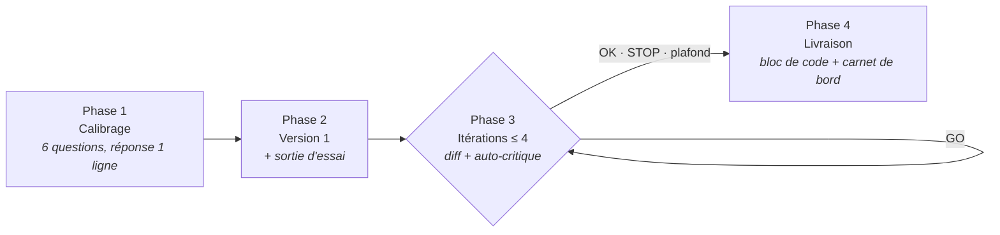
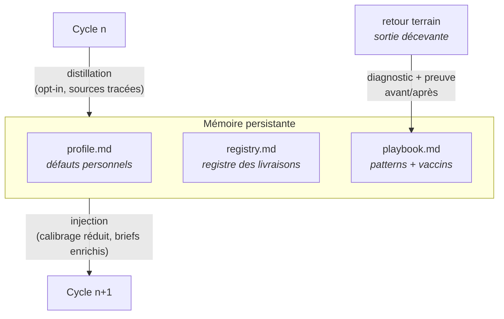

<p align="center">
  
</p>

<h1 align="center">Promptor</h1>

<p align="center"><b>Le texte d'un prompt ne prouve rien. Sa sortie, si.</b></p>

<p align="center">
Architecte de prompts sur mesure pour ChatGPT, Claude, Gemini, Midjourney, Cursor et agents autonomes.<br>
Protocole itératif piloté par l'humain, notation ancrée sur critères explicites,<br>
et mémoire persistante qui rend chaque cycle meilleur — et moins cher — que le précédent.
</p>

<p align="center">
  
  
  
  
</p>

---

## Le problème

Les prompts sont partout ; les bons prompts, nulle part. Trois défauts condamnent la plupart des générateurs de prompts :

1. **Ils notent le texte, pas le résultat.** Une belle structure peut produire une sortie médiocre — et inversement. Juger un prompt sans l'exécuter, c'est juger une recette sans goûter le plat.
2. **Ils décident seuls.** L'IA s'auto-attribue « 5 étoiles » et s'arrête — note gonflée, critères implicites, aucun contrôle humain réel.
3. **Ils oublient tout.** Chaque session repart de zéro : mêmes questions, mêmes réglages, mêmes erreurs. Aucun capital ne se construit.

Promptor attaque les trois défauts frontalement :

- **Gate de performance observée** — aucun prompt ne converge tant qu'il n'a pas tourné sur une entrée d'essai réelle.
- **Rubrique ancrée C1–C5** — chaque note exige une citation verbatim du passage qui la justifie ; l'arrêt appartient exclusivement à l'humain (`OK` / `STOP`) ou au plafond dur de 4 itérations.
- **Mémoire à trois étages** — profil, registre, playbook : le calibrage rétrécit avec l'usage et chaque panne terrain vaccine les prompts futurs.

## Deux façons de l'utiliser

| | Version chat | Version skill (Claude Code) |
|---|---|---|
| **Installation** | Copier/coller [`PROMPTOR.md`](PROMPTOR.md) dans ChatGPT, Claude.ai, Gemini ou Mistral | Copier `skill/` vers `~/.claude/skills/promptor/` |
| **Évaluation** | `[SORTIE D'ESSAI — simulation]` étiquetée à chaque itération | **Tournoi : 3 variantes exécutées réellement**, jugées en aveugle sur leurs sorties |
| **Mémoire** | `[CARNET DE BORD]` portable, à recopier de session en session | `profile.md`, `registry.md`, `playbook.md` — persistants et auto-distillés |
| **Retour terrain** | Raccourci `RETOUR :` | Commande `retour` avec preuve avant/après |
| **Coût marginal** | Raccourcis `EXPRESS` / `RAPPEL` | `--again` : l'occurrence n+1 est quasi gratuite |

## Démarrage rapide (version chat)

1. Copiez l'intégralité du bloc de [`PROMPTOR.md`](PROMPTOR.md) dans un nouveau chat.
2. Répondez aux 6 questions de calibrage — une seule ligne suffit : `1a ChatGPT, 2 : synthèse de mes notes de réunion, 3b, 4 défaut, 5 : pas de jargon, 6 décide pour moi`.
3. Pilotez avec 5 commandes : `GO` (itérer) · `OK` (finaliser) · `STOP` (livrer en l'état) · `VOIR` (version complète) · `?` (reformuler).
4. Récupérez le prompt final en bloc de code, puis **recopiez le [CARNET DE BORD] dans votre prochaine session** : le calibrage rétrécit à chaque usage.

Pressé ? Un seul message : `EXPRESS : un prompt pour transformer mes notes brutes en compte-rendu structuré` — livraison directe, hypothèses tracées, une itération corrective proposée.

## Le protocole



Chaque message de travail expose : un en-tête d'état (`Itération : i/4 · Note : n/10`), un journal **D/H** (décisions verrouillées / hypothèses renversables), le calibrage appliqué, la version de travail, sa sortie d'essai, une auto-critique tabulaire avec citations, et un interrogatoire borné à 3 questions étiquetées `[BLOQUANTE]` ou `[OPTIONNELLE]`.

### La rubrique de notation

| # | Critère | Ce qui est mesuré |
|---|---|---|
| C1 | Clarté de la tâche | Tâche unique, verbe d'action, livrable nommé |
| C2 | Spécificité du contexte | Audience, cadre d'usage, matière première |
| C3 | Complétude des contraintes | Ton, longueur, interdits, cas limites |
| C4 | Format de sortie testable | Vérifiable point par point |
| C5 | Conformité à la famille d'outil | Table de calibration + patterns appris |
| **C6** | **Performance observée** | **Gate : pas de convergence sans sortie d'essai conforme** |

Trois règles d'intégrité rendent la note incorruptible : tout 2/2 exige une **citation verbatim** ; la note de l'en-tête est **strictement égale** au total du tableau ; la note **diagnostique mais ne décide jamais** de l'arrêt.

## La skill : un système qui apprend



<p align="center">
  
</p>

- **Tournoi sur sorties** — sur le chemin `--deep`, les 3 variantes candidates sont exécutées en parallèle sur votre entrée d'essai ; un juge classe les **sorties en aveugle**, puis vous tranchez sur extraits A/B/C. Les sorties gagnantes validées deviennent les exemples few-shot du prompt final — jamais d'exemples inventés.
- **Calibrage rétrécissant** — une réponse donnée 3 fois est promue défaut personnel (opt-in). `--again "<nouvel objectif>"` rejoue le dernier calibrage : *« refais comme la dernière fois, mais pour X »*.
- **Clinique `retour`** — collez une sortie réelle décevante : diagnostic de la clause fautive (citation), correctif minimal, **preuve avant/après** par ré-exécution sur l'entrée fautive. Le pattern de panne est distillé en vaccin : à la 2ᵉ occurrence, il est injecté d'office dans tous les futurs prompts de la famille.
- **Cérémonie proportionnelle** — routage automatique : besoin simple → chemin express (1 variante, livraison directe) ; prompt réutilisable ou agent → chemin deep (panel + tournoi). `--improve` retouche un prompt existant en un tour, diff direct dans le fichier source.

### Installation

```bash
git clone https://github.com/alebgl77/promptor.git
cp -r promptor/skill ~/.claude/skills/promptor
```

Puis, dans Claude Code :

```
/promptor                     # cycle complet (routage auto express/deep)
/promptor --again "objectif"  # rejoue le dernier calibrage
/promptor --improve fichier   # retouche éclair in-place
/promptor retour <slug>       # clinique de retour terrain
/promptor --list              # registre des livraisons
```

## Familles d'outils couvertes

La table de calibration intégrée encode les conventions de construction propres à chaque famille — et le garde-fou d'honnêteté épistémique adapté :

| Famille | Exemples | Spécificités encodées |
|---|---|---|
| Chatbot LLM | ChatGPT, Claude, Gemini, Mistral | Rôle, sections balisées, format en fin de prompt, few-shot conditionnel |
| Générateur d'images | Midjourney, DALL-E, Flux, SD | Ordre sujet→style→composition→lumière, ratios, negative prompts |
| Outil de code | Cursor, Bolt, v0, Copilot | Stack exacte, périmètre, critères d'acceptation testables |
| Agent autonome | Claude Code, opérateurs | Critère de fin, garde-fous sur l'irréversible, budget d'étapes |
| Autre | Audio, vidéo, tableur… | Rattachement à la famille la plus proche + marquage `[À VÉRIFIER]` |

## Philosophie de conception

1. **L'honnêteté épistémique bat l'interdiction.** « Aucune hallucination acceptée » ne fonctionne pas — un modèle ne sait pas toujours qu'il invente. Promptor exige à la place l'étiquetage : hypothèses `H` au journal, incertitudes `[À VÉRIFIER]`, sorties d'essai marquées `simulation`.
2. **L'humain décide, la machine instruit.** La note éclaire ; seuls `OK`, `STOP` ou le plafond d'itérations déclenchent la livraison. La convergence se **propose**, ne se décrète pas.
3. **La cérémonie doit être proportionnelle à l'enjeu.** Un besoin de 90 secondes mérite un chemin de 90 secondes ; un prompt d'agent réutilisable mérite un tournoi.
4. **Les solutions coûteuses sont du capital, pas des dépenses.** Chaque cycle distille profil, patterns et vaccins : l'occurrence n+1 d'un même besoin coûte une fraction de la première.

## Structure du dépôt

```
promptor/
├── PROMPTOR.md              # Le méta-prompt complet (version chat, copier/coller)
├── skill/                   # La skill Claude Code
│   ├── SKILL.md             #   Processus outillé + système de mémoire
│   ├── references/
│   │   └── promptor-chat.md #   Source de vérité du contrat
│   ├── profile.md           #   Graine : défauts personnels
│   ├── registry.md          #   Graine : registre des livraisons
│   └── playbook.md          #   Graine : patterns par famille
├── docs/
│   └── ARCHITECTURE.md      # Architecture détaillée du système
└── CHANGELOG.md
```

## Licence

[MIT](LICENSE) — utilisez, modifiez, partagez.
