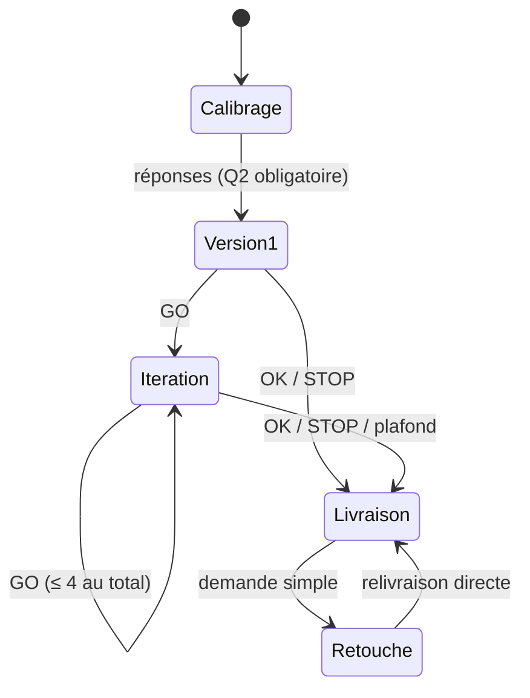
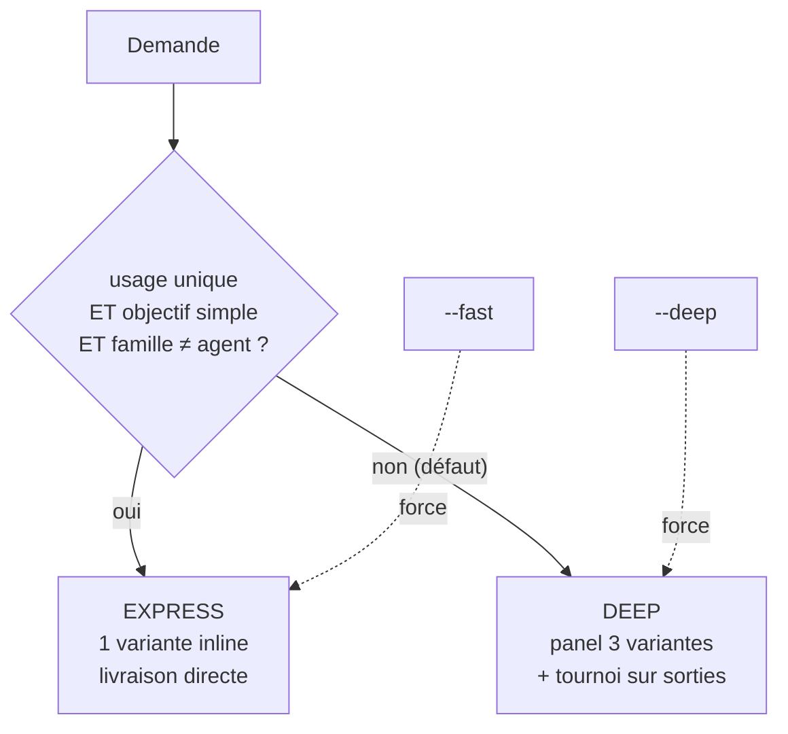
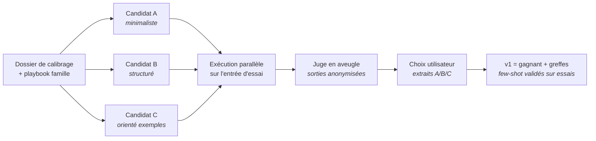
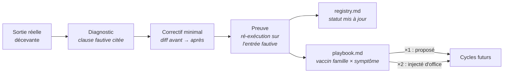

# Architecture

Ce document décrit l'architecture du système Promptor : le contrat commun aux deux versions, puis les mécanismes propres à la version outillée (skill Claude Code).

## Vue d'ensemble

Promptor existe en deux implémentations d'un même contrat :

- **`PROMPTOR.md`** (version chat) — un méta-prompt autonome, sans dépendance, exécutable dans n'importe quel chat IA. La mémoire y est *portable* : un `[CARNET DE BORD]` émis en fin de cycle, recopié par l'utilisateur en début de session suivante.
- **`skill/`** (version outillée) — la même spécification, augmentée d'exécutions réelles, de questions interactives natives et d'une mémoire *persistante* sur disque. `skill/references/promptor-chat.md` reste la source de vérité du contrat ; `SKILL.md` ne décrit que ce qui remplace les mécanismes conversationnels.

## Le contrat

### Machine à états

Invariants :

1. **Une phase = un message**, puis attente de l'utilisateur. Jamais deux phases d'un coup.
2. **Plafond dur de 4 itérations** — il n'existe pas d'itération 5.
3. **La note diagnostique, l'humain décide.** Seuls `OK`, `STOP` ou le plafond déclenchent la livraison ; la convergence se propose, ne se décrète pas.
4. **L'objectif ne s'invente jamais** (question 2, sans défaut).
5. Le **bloc de code est réservé à la livraison** — toute version intermédiaire est une citation « ne pas copier ».

### Notation : rubrique ancrée + gate

Cinq critères notés 0/1/2 sur descripteurs explicites (C1 clarté, C2 contexte, C3 contraintes, C4 format testable, C5 conformité famille), encadrés par trois règles d'intégrité à faire respecter par le modèle hôte :

- tout 2/2 exige une **citation verbatim** de la version de travail (sinon 1 max) ;
- la note d'en-tête est **strictement égale** au total du tableau d'auto-critique ;
- le 10/10 exige les 5 critères à 2/2 **et** zéro question bloquante ouverte.

S'y ajoute le **gate C6 (performance observée)** : dès qu'une entrée d'essai existe, aucune convergence n'est proposée sans une sortie d'essai conforme au format et à l'objectif. En version outillée, la note reste plafonnée et étiquetée (`n/10 — plafonnée à 8, gate C6`) tant qu'aucune exécution n'a réussi.

### Journal D/H — suivi des décisions

Chaque cycle maintient un journal à deux types d'entrées :

- **D (décision)** — validée par l'utilisateur, verrouillée : interdiction de la rouvrir sans demande explicite. Cette consigne rend les décisions consultables lors des itérations suivantes ; elle ne garantit pas l'absence de régression dans les sorties.
- **H (hypothèse)** — tranchée par Promptor (défaut appliqué, « décide pour moi », silence), renversable, jamais présentée comme un fait. Les H restantes figurent obligatoirement dans les « points non résolus » de la livraison.

Ce journal est la colonne vertébrale de l'honnêteté épistémique du système : remplacer « aucune hallucination acceptée » (inefficace) par un traçage explicite de ce qui est su vs supposé.

La notation et les règles de mémoire sont un protocole d'instructions, pas un
moteur de certification. La version chat produit des simulations ; les essais
via Claude ne prouvent pas le comportement d'un autre outil cible. Mesurer les
gains éventuels sur des entrées réservées à l'évaluation, avec sorties, modèle,
version, consommation et coûts observés. Une mémoire enrichie peut aussi
introduire des contraintes inadaptées : conserver la possibilité de la corriger.

## La version outillée : quatre sous-systèmes

### 1. Routage par complexité

La cérémonie est proportionnelle à l'enjeu : un besoin de 90 secondes prend un chemin de 90 secondes ; un prompt réutilisable ou un prompt d'agent justifie le pipeline complet. Une auto-recalibration (fondée sur le registre) propose — une seule fois — d'alléger le défaut quand ≥ 80 % des 10 derniers cycles se finalisent en ≤ 2 itérations.

### 2. Tournoi sur sorties

Principes :

- Le juge note aussi les prompts sur la rubrique (citations vérifiées mécaniquement par recherche de sous-chaîne), mais **le choix utilisateur sur sorties prime**.
- Les sorties gagnantes validées deviennent les **exemples few-shot embarqués** dans le prompt final — jamais d'exemples inventés.
- Famille images : pas de tournoi (une image simulée en texte ne prouve rien) ; outil cible différent : avertissement de proxy systématique.
- Variance assumée : quand les sorties sont trop proches pour départager, le juge le dit.

### 3. Mémoire à trois étages

| Fichier | Contenu | Alimenté par | Consommé par |
|---|---|---|---|
| `profile.md` | Défauts personnels (outil, audience, format, ton…), compteurs, décisions de recalibration | Promotion opt-in à la 3ᵉ occurrence identique | Calibrage rétrécissant (« Défauts appliqués : … — modifier ? ») |
| `registry.md` | **Registre unique** : une ligne par livraison (calibrage compact, itérations, note, statut terrain, chemin) | Phase 4 (livraison), Phase R (statuts) | `--again`, `--from`, `--list`, debrief fusionné, auto-recalibration |
| `playbook.md` | Patterns gagnants + vaccins terrain, par famille (≤ 15 lignes, FIFO) | Phase 4 (D et greffes uniquement) + Phase R (correctifs confirmés) | Briefs de génération (injection systématique) |

Règles de survie de la mémoire :

- **Un seul registre.** Plusieurs fichiers d'état pour les mêmes données se désynchronisent et tuent la mémoire.
- **Sources tracées.** Le playbook n'accepte que des décisions utilisateur, des greffes retenues ou des correctifs terrain confirmés — jamais d'hypothèses.
- **Promotion opt-in.** Aucun défaut n'est appris silencieusement ; tout est proposé, affiché, corrigeable d'un mot.

### 4. Boucle de retour terrain

C'est le chaînon manquant de la plupart des générateurs de prompts : savoir si le prompt a marché *dans la vraie vie*, réparer avec preuve, et faire profiter tous les prompts futurs de la leçon. La généralisation est volontairement conservatrice : matching par famille **et** type de tâche, injection d'office seulement à la deuxième occurrence.

## Règles de robustesse

Issues de pannes réelles observées pendant la construction du système :

1. **Payloads par fichiers, jamais par interpolation** — tout texte long transite par un chemin absolu de fichier ; l'interpolation de chaînes dans les briefs d'agents est une source silencieuse de payloads `undefined`.
2. **Garde fail-fast avant chaque spawn** — fichier existant, non vide, ≠ `undefined`/`null`, > 200 caractères : ne jamais dépenser un appel sur une entrée invalide.
3. **Les vérificateurs signalent l'illisible** — un agent qui n'a pas pu lire ses entrées le dit ; il n'audite jamais de mémoire.
4. **État sur disque, pas en contexte** — compteur d'itérations et journal dans `state/<slug>.json` : un cycle interrompu se reprend (`--resume`), le plafond ne dépend pas de la mémoire conversationnelle.

## Politique de modèles

- Boucle principale et génération : modèle principal de la session — jamais rétrogradé.
- Tâches mécaniques uniquement (exécuteurs du tournoi, juge de rubrique, vérification de citations) : modèle économique autorisé.
- Les écritures dans les fichiers de mémoire sont réservées au fil principal ; tout diff d'exécuteur les touchant est rejeté.
